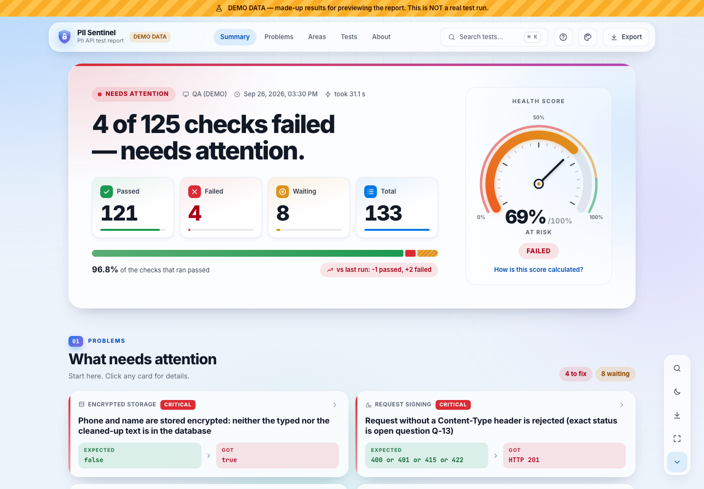
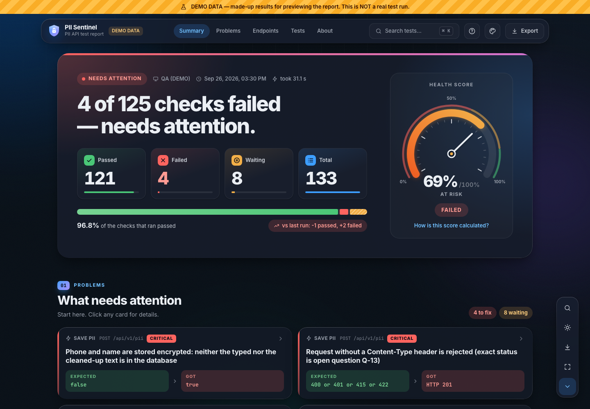
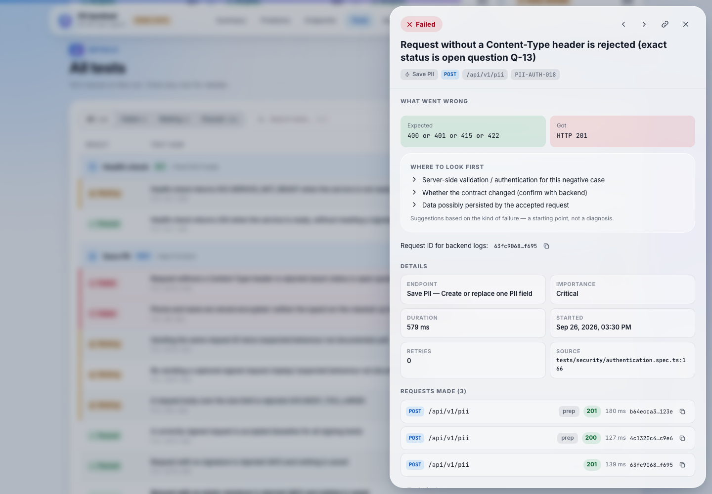
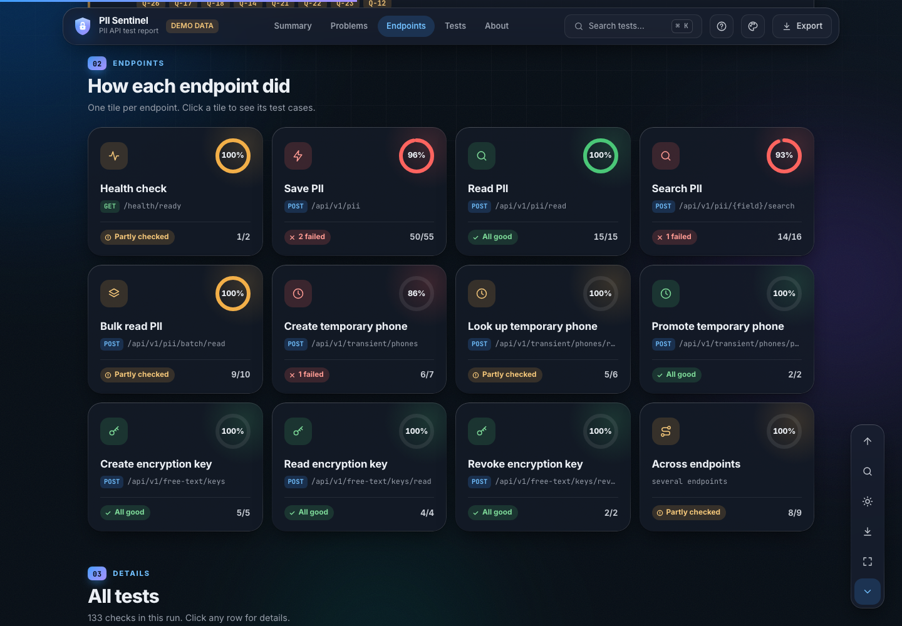
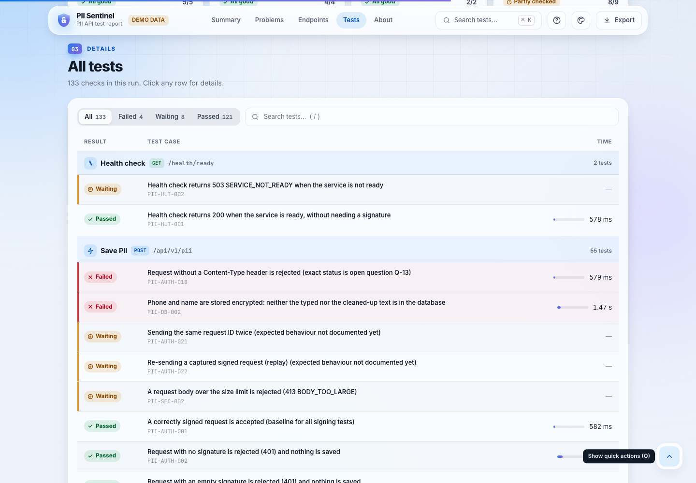
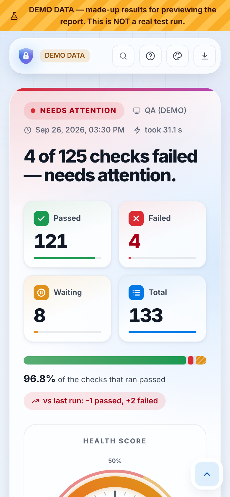
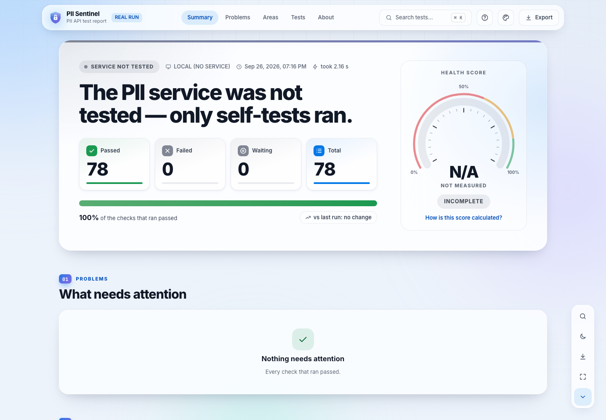

# PII Sentinel — the test report

A small, single-page report anyone can read in seconds. It is generated after every test run, needs no server,
and never contains personal data.



## What’s on the page

The top bar links straight to each part (Summary · Problems · Endpoints · Tests · About) and highlights where you are.

| Block                          | What it tells you                                                                                                                                                                                                                                                                                                                                                         |
| ------------------------------ | ------------------------------------------------------------------------------------------------------------------------------------------------------------------------------------------------------------------------------------------------------------------------------------------------------------------------------------------------------------------------- |
| **Summary**                    | A coloured banner: a status pill (“Needs attention”, “All clear”, “Service unreachable”, “Service not tested”), one plain sentence with the answer, four big numbers (Pass · Fail · Not Tested · Total) for **every** test case, one bar, “vs last run” and the **health score** speedometer (0–100%).                                                                    |
| **01 · What needs attention**  | One card per failure showing the endpoint (name, method, path), whether it is critical, and **Expected → Got** side by side. Below that, one card saying how many tests were **not tested** and why (not part of this run, waiting on Dev, skipped). If the service was unreachable you see **one** clear message instead of dozens of failures.                          |
| **02 · How each endpoint did** | Milestone 1: one tile per API endpoint (name, method and path) with a ring and a pass percentage, plus “Across endpoints”. Milestone 2: one tile per **API area** (G1–G10) with ring and passed / failed / blocked. Names and paths are never cropped. Clicking a tile opens the **side panel** (see below).                                                              |
| **03 · All tests**             | The full list, **grouped under a heading per endpoint** (or type / category / suite), with the filter bar described below, a one-line description under each test, a coloured edge on failed rows, and a small bar showing each test’s duration. Click any row to see **what the test does, why it matters, its steps and expected result**, then the result of this run. |
| **04 · About this run**        | Environment, time, duration, typical response time, framework self-test result, leftover test data and commit.                                                                                                                                                                                                                                                            |

**Filtering the test list.** Row 1 is one line on a desktop: **Group by** (`Endpoint | Type | Category | Suite |
None`) · **Show** (only for Type / Suite / Category: All, then Positive / Negative / … ; Smoke / Regression; the
categories present) · **Status** (All · Pass · Fail · Security finding · Blocked · Skipped · Not tested, plus Not
applicable only when some test has it) · **Area** (Milestone 2, G1–G10, names from `m2/scripts/m2-inventory.ts`) ·
**Endpoint** (only when Group by = Endpoint; searchable on method, path or action name, limited to the chosen area) ·
search · **Export CSV** (same columns as `results.csv`, only the shown tests). Every option shows its name and count,
e.g. “Positive (412)”; counts follow the other filters. Row 2 appears only while a filter is set: one removable chip
per filter (“Type: Positive ✕”, “Status: Fail ✕”, “Area: G4 … ✕”, “Endpoint: POST /V1/like ✕”, “Search: “like” ✕”),
“Showing X of Y tests” and **Clear all**. Long values end in “…” with the full text as a tooltip; the bar wraps on
narrow screens. The view is kept in the URL hash (`#by=type&show=Positive`, `#area=G3&endpoint=API-011`, plus
`status`, `q`, `test`), so a copied link opens the same view.

**Side panel (endpoint explorer).** Clicking an area tile opens the right-side panel (same panel as test details):
level 1 lists the area's endpoints (method, full path, action name, a small pass / fail / blocked bar, test count)
with a “Filter endpoints…” box; level 2 shows one endpoint's tests grouped by type with a status dot; level 3 is the
usual test details. A breadcrumb (“Area › Endpoint › Test”) and the back arrow go up one level; Escape closes the
panel; focus stays inside it. **Show in test list** (levels 1 and 2) applies that area / endpoint as a chip on the main
list and closes the panel. Milestone 1 (no areas) opens straight at level 2. The panel state is in the URL hash
(`#panelArea=G3&panelEndpoint=API-011&test=…`), so it reopens on reload.

Also on the page: light, dark and auto themes; six accent colours; a floating quick-action bar whose last button
folds it away (back-to-top only appears once you scroll); and Export (PDF, Excel, raw CSV, JSON, Slack/ClickUp summary). The Excel file is built by the same code as
`m1/docs/test-cases.xlsx`, so it has exactly the same design.

**Keyboard:** `⌘/Ctrl K` search · `/` search tests · `1`–`4` sections · `0`/`Home` top · `F` `W` `A` fail / not tested /
all · `←` `→` pages · `J` `K` next / previous test · `E` export · `D` dark mode · `Q` quick-action bar · `Esc` close ·
`?` all shortcuts.

## Commands

```bash
npm run m1:test:all        # run service tests → report → PDF (pass Playwright args after --, e.g. -- --grep @smoke)
npm run report          # build the report from the last run  → reports/qa-report/index.html
npm run report:pdf      # PDF of it                           → reports/qa-report/report.pdf
npm run report:open     # open it
npm run report:demo     # preview with made-up DEMO data      → reports/demo-report/
npm run report:dev      # live-reloading preview while editing the report
npm run report:test     # tests for the report itself
npm run report:clean    # delete generated reports (-- --all also deletes run history)
```

## Rules the report follows

- **Nothing is invented.** Every number comes from recorded results. Missing data shows as “N/A” with a reason.
- **Service tests only.** Framework self-tests are shown as a single line in “About this run” and never inflate
  the service numbers.
- **Health score** (0–100%, shown on a speedometer: red below 60%, amber 60–85%, green from 85%): pass rate 50%, critical-check pass rate 25%, share of checks that ran 15%, and endpoints that
  actually responded 10%. It is capped at 69% if a critical check failed. Checks that never reached the service are
  left out, so an unreachable service shows “not measured”. A run with only framework self-tests also shows N/A. The page explains this via “How is this score calculated?”,
  and the weights live in `reporting/config/report-config.json`.
- **“vs last run”** only compares runs of the same kind (same projects and filters), so smoke runs are not
  compared with full regressions.
- **Self-tests are not a service result.** If only the framework's own tests ran, the page says “The PII service was
  not tested” and shows no health score.
- **Demo data** is always labelled: striped ribbon, “DEMO DATA” tag, PDF header and summary tag. It can never enter real
  run history.

## Privacy

The report stores only test names, results, timings, HTTP status codes and random request IDs. Request and response
bodies, headers, signatures, keys and credentials are never collected. All text is scrubbed three times: when it is
collected, when the report is built, and when the page shows it. The build **refuses to write** a report whose data
looks like an email, private key or signature. A test injects real-looking secrets and checks that none of them reach
the page or any file.

## How it works (for maintainers)

```
Playwright run ─▶ reporting/collector  (allow-listed, sanitized)  ─▶ reports/latest/run-data.json
               ─▶ reporting/generator  (validate · enrich · history · self-check · bundle)
               ─▶ reports/qa-report/  index.html · assets/ · data/ · report.pdf · test-cases.xlsx · results.csv · results.json · summary.txt
```

- `reporting/core/` — data model, analytics, sanitizer, exporters (shared by the generator and the page)
- `reporting/dashboard/src/` — the page (Preact, about 100 KB, no chart library; the speedometer and rings are plain SVG)
- `reports/history/` — one small file per real run, which powers “vs last run”. CI keeps it between runs.

## Screenshots

|                                        |                                        |
| -------------------------------------- | -------------------------------------- |
|     |    |
|  |  |
|          |        |

Screenshots 01–06 use demo data. Screenshot 07 is a real local run where only the framework self-tests ran.

The same endpoint grouping is used in [test-cases.xlsx](../m1/docs/test-cases.xlsx): one “Test Cases” sheet with a linked
summary at the top and a coloured section per endpoint. The report’s Export → Excel (.xlsx) gives the same file.

**Statuses.** Only Pass, Fail and Not Tested are shown. Every test in the suite is always listed; tests that were not
part of the run show as Not Tested and do **not** affect the health score, which measures only what ran.
